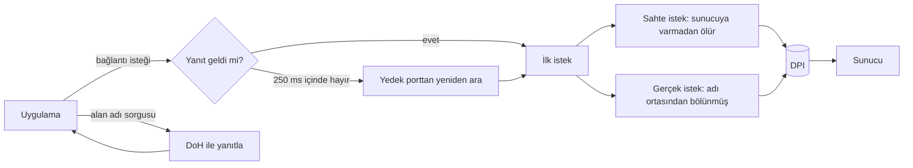

# BABAYLA ZOR YARIŞIRLAR, BIKTIM AQ ÇALIŞMAYAN GOODBYEPIDEN ILLA KENDIMIZ MI YAPALIM KARDEŞİM

<p align="center">
  
</p>

<h3 align="center">SONdpi — Windows için tek anahtarlı DPI atlatma aracı</h3>

<p align="center">
  Discord, Roblox ve benzeri sitelere erişimi engelleyen derin paket incelemesini (DPI) atlatır.<br>
  Bildirim alanında durur: bir tık açar, bir tık kapatır. Terminal yok, ayar dosyası yok.
</p>

<p align="center">
  
  
  
  
  
  
  
</p>

> [!WARNING]
> **Erken sürüm.** Motor 118 birim testinden geçiyor, ama gerçek hattaki sınaması henüz tamamlanmadı. Hat ölçümleri şu an yalnızca Turkcell 5G ev internetinde yapıldı; başka servis sağlayıcılarda denenmedi. Bozuk bir şey görürsen [sorun aç](https://github.com/uruskan/SONdpi/issues).

## Neden var

Çünkü 2026 yılındayız ve bir siteye girmek için hâlâ sekiz ayrı `.cmd` dosyasından hangisinin bugün çalıştığını tahmin etmemiz bekleniyor. `alternative2` mi, `alternative5_superonline` mı, yoksa yıldız haritana göre `alternative6` mı?

Hayır. Bir anahtar olmalı. Açarsın, çalışır. Kapatırsın, hiçbir iz kalmaz. Roket bilimi değil; roket bilimi olsaydı daha kolay olurdu, en azından roketin tek bir fırlatma düğmesi var.

## Ne yapar

| | |
|---|---|
| **Engeli atlatır** | Engelli siteye giden ilk isteği (TLS ClientHello, HTTP Host) denetim cihazının okuyamayacağı biçimde yollar: önce sunucuya varmadan ölen sahte bir istek, sonra alan adı ortasından bölünmüş gerçek istek. |
| **Kopan bağlantıyı kurtarır** | Yanıt gelmeyen bağlantıyı çeyrek saniye içinde başka bir kaynak porttan yeniden arar ve kazanan yolu uygulamaya fark ettirmeden çevirir. Bildiğimiz kadarıyla benzer araçlarda yok. |
| **DNS'i temizler** | Alan adı sorgularını yakalar ve şifreli DNS (DoH) ile yanıtlar. Bağdaştırıcı ya da modem ayarına dokunmaz; IPv4, IPv6 ve modemin `fe80::` adresli çözümleyicisinde çalışır. |
| **Sisteme dokunmaz** | Ağ ayarı, DNS ayarı, güvenlik duvarı kuralı değiştirmez. Kapatınca her şey açmadan önceki hâlindedir. |
| **Tek program** | `sondpi.exe` ve yanında iki sürücü dosyası. Kendini kurar, kendini kaldırır. |

## GoodbyeDPI'den farkı

[GoodbyeDPI](https://github.com/ValdikSS/GoodbyeDPI) bu işin atasıdır ve yıllardır çok sayıda insanın derdine deva oluyor; SONdpi onun fikirlerinin üstüne kurulu. Farklar şunlar:

| | GoodbyeDPI | SONdpi |
|---|---|---|
| Arayüz | Komut satırı ve `.cmd` dosyaları | Bildirim alanında tek anahtar |
| Ayar | Parametreyi ve "alternatif" betiği sen seçersin | Varsayılanla gelir; hattı ölçüp kendi seçmesi yol haritasında |
| DNS | Sorgunun hedefini yeniden yazar; modemin IPv6 bağlantı-yerel çözümleyicisinde takılıyor (ölçtük) | Sorguyu yakalar, yanıtı DoH ile kendi üretir |
| Yanıtsız kalan bağlantı | Yapacak bir şeyi yok | 250 ms'de yedek porttan yeniden arar |
| Açılışta başlama | Servis betiğini elle kurarsın | Kurulumla gelir |
| Olgunluk | Yıllardır sahada | Yeni; erken sürüm |

Son satırı atlama. GoodbyeDPI kendini kanıtladı, SONdpi henüz kanıtlıyor.

## Nasıl çalışır



1. **Sahte istek.** Gerçek isteğin hemen önünde, izinli bir alan adı taşıyan ve yaşam süresi (TTL) sunucuya varmadan biten bir kopya gider. Denetim cihazı onu görüp akışı serbest bırakır; sunucu hiç görmez.
2. **Bölme.** Gerçek istek, alan adının ortasından ikiye bölünür ve ikinci parça önce yollanır. Hiçbir pakette adın tamamı yoktur.
3. **Yeniden arama.** Bazı hatlarda bağlantı isteğinin (SYN) kendisi kaybolur ve işletim sisteminin tekrarları da aynı yolda kaybolur. SONdpi aynı isteği başka bir kaynak porttan yollar; hangisi önce yanıt alırsa bağlantı onun üstünden kurulur.
4. **DNS.** Giden sorgu yakalanır, yanıt şifreli kanaldan alınır ve asıl çözümleyiciden gelmiş gibi geri verilir.

Paket yakalama için [WinDivert](https://reqrypt.org/windivert.html) sürücüsü kullanılır; GoodbyeDPI'nin de kullandığı imzalı sürücüdür.

## Kurulum

1. [Sürümler](https://github.com/uruskan/SONdpi/releases) sayfasından son paketi indir ve bir klasöre aç.
2. `sondpi.exe` dosyasına çift tıkla. Windows bir kez yönetici onayı ister (sürücü ve servis için).
3. Saatin yanındaki bildirim alanında anahtar simgesi belirir. Yeşilse açıktır.

> Henüz yayınlanmış sürüm yoksa kaynaktan derleyebilirsin; aşağıda.

## Kullanım

- **Sol tık:** aç / kapat.
- **Sağ tık:** durum (korunan bağlantı, kurtarılan bağlantı, DNS yanıtı sayıları), "Windows açılışında başlat", "SONdpi'yi kaldır", "Çıkış".
- **Simge rengi:** yeşil açık, gri kapalı, sarı sorun var (ayrıntı menüde yazar).

## Bu hatta ne ölçtük

Aracı tahminle değil ölçümle yazdık. Kasım 2026, Turkcell 5G ev interneti:

| Ölçüm | Sonuç |
|---|---|
| Engelli SNI, hiçbir araç yokken | İstek sessizce düşürülüyor, bağlantı zaman aşımına uğruyor |
| İstek bölünüyor ama sahte paket denetim cihazına ulaşmıyor | 0,2 saniyede sıfırlama (RST) |
| Sahte paketin TTL'i 3, 4, 5 | Hiç çalışmıyor |
| Sahte paketin TTL'i 8 ve üstü | Çalışıyor |
| Sağlama toplamı bozuk ya da sıra numarası eski sahte paket | Çalışmıyor |
| IPv4 ile Cloudflare adreslerine bağlantı isteği | %7–11'i yanıtsız; işletim sisteminin tekrarları da |
| Aynı adreslere IPv6 ile | %0 yanıtsız |
| GitHub'ın Frankfurt adresine IPv4 ile | %4 yanıtsız |
| Google, Akamai, Fastly, CloudFront, Roblox adreslerine | %0 yanıtsız |
| Modemin çözümleyicisi, engelli alan adı | Engel sayfasının adresini döndürüyor |

Yani "GoodbyeDPI çalışıyor ama on bağlantıdan biri takılıyor" şikâyetinin nedeni DPI değil, kaybolan bağlantı istekleriydi. Yeniden arama bunun için var.

## Sık sorulanlar

**VPN mi bu?**
Hayır. Trafiğin başka bir ülkeye gitmez, IP adresin değişmez, hızın bir sunucuya bağlı kalmaz. Yalnızca ilk paketlerin biçimi değişir.

**Virüs mü?**
Kaynak kodu burada, tek bağımlılığı Microsoft'un `windows-sys` paketi. Yönetici hakkı ister, çünkü paket yakalayan her araç ister. Bazı antivirüsler WinDivert sürücüsünü "riskli araç" diye işaretleyebilir; bu GoodbyeDPI'de de böyledir.

**Hangi servis sağlayıcıda çalışır?**
Turkcell 5G'de ölçüldü. Türk Telekom, Superonline, Vodafone ve diğerlerinde henüz denenmedi. Denersen sonucu yaz, tabloya ekleyelim.

**İnternetimi yavaşlatır mı?**
Bağlantının ilk paketlerine, DNS sorgularına ve yeniden aranan bağlantılara dokunur; geri kalan trafik olduğu gibi akar. Hız ölçümleri gerçek hat testleriyle birlikte yayınlanacak.

**Kapatınca ne olur?**
Açmadan önce ne idiyse o. Değiştirdiği bir sistem ayarı yok ki geri alsın.

**IP ile engellenen siteleri açar mı?**
Hayır. Bu araç alan adına bakan engeli (SNI, Host, DNS) atlatır. Adresin kendisi engelliyse VPN gerekir.

**Oyunlarda ban yer miyim?**
Bilmiyoruz ve söz veremeyiz. Araç oyunun kendisine dokunmaz, ama hile korumalarının paket yakalayan sürücülere nasıl davrandığı oyundan oyuna değişir.

**Mars'ta çalışır mı?**
Gecikme 4 ile 24 dakika arasında olacağı için yeniden arama eşiğini 250 ms'den biraz yükseltmen gerekir. Yol haritasında değil.

## Yol haritası

- [ ] Hattı ölçüp çalışan yöntemi kendisi seçen kalibrasyon
- [ ] Türk Telekom, Superonline, Vodafone ölçümleri
- [ ] QUIC (HTTP/3) için yöntem
- [ ] Discord sesli kanal (UDP) için yöntem, gerekiyorsa
- [ ] Kurulum paketi ve imzalı sürüm

## Kaynaktan derleme

Rust (MSVC araç zinciri) kurulu bir Windows'ta:

```
git clone https://github.com/uruskan/SONdpi
cd SONdpi
cargo test
cargo build --release
```

`target\release\sondpi.exe` dosyasının yanına `vendor\windivert\` içindeki `WinDivert.dll` ve `WinDivert64.sys` dosyalarını kopyala.

## English

**SONdpi** is a one-switch DPI circumvention tool for Windows 10/11, written in Rust. It lives in the notification area (system tray): one click on, one click off, no terminal and no configuration files. It is an alternative to GoodbyeDPI built for networks in Türkiye, where sites such as Discord and Roblox are blocked by SNI inspection and poisoned DNS.

- **Desync:** a TTL-limited fake TLS ClientHello / HTTP request followed by the real one split in the middle of the host name.
- **SYN re-dial:** a connection attempt that gets no answer within 250 ms is re-sent from another source port and translated transparently.
- **DNS:** intercepted DNS queries are answered locally over DNS-over-HTTPS; no adapter settings are changed.
- **Status:** early release; measured on one ISP so far. Built on the WinDivert driver.

## Teşekkür ve lisans

- [GoodbyeDPI](https://github.com/ValdikSS/GoodbyeDPI) ve [zapret](https://github.com/bol-van/zapret): yöntemlerin çoğunu onlar buldu.
- [WinDivert](https://reqrypt.org/windivert.html): paket yakalama sürücüsü (LGPLv3). Dosyaları ve lisansı `vendor/windivert/` altında.

Kod [MIT](LICENSE) lisanslıdır. Aracı nasıl ve nerede kullandığın senin sorumluluğundadır.

<sub>İlgili aramalar: DPI atlatma, DPI bypass, Discord engeli kaldırma, Discord'a girme, Roblox engeli, GoodbyeDPI alternatifi, GoodbyeDPI çalışmıyor, zapret Windows, SNI engeli, DNS zehirlenmesi, DoH, Turkcell, Türk Telekom, Superonline, Vodafone, Windows 11.</sub>
